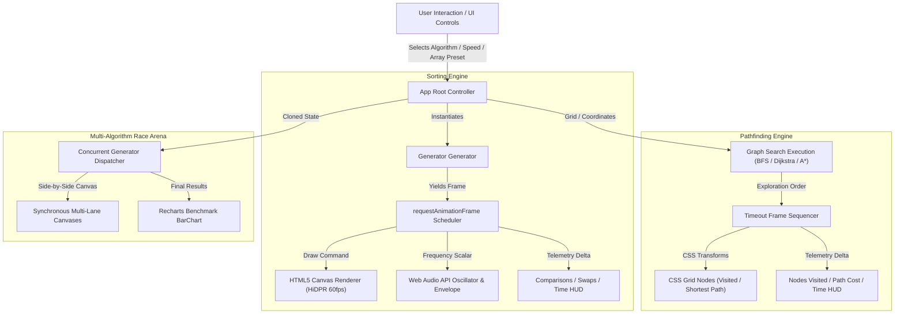
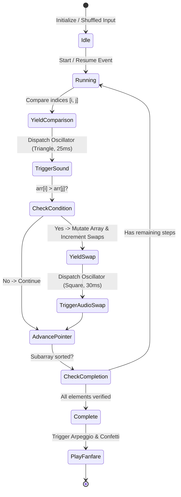
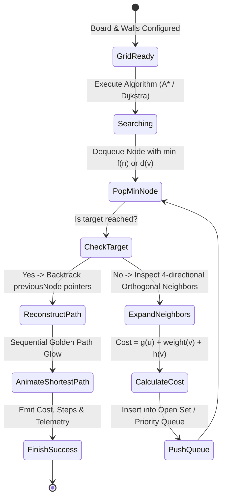

# AlgoScope — Sorting & Pathfinding Algorithm Visualizer

[](https://www.typescriptlang.org/)
[](https://reactjs.org/)
[](https://vitejs.dev/)
[](https://tailwindcss.com/)
[](https://developer.mozilla.org/en-US/docs/Web/API/Web_Audio_API)
[](https://opensource.org/licenses/MIT)

**AlgoScope** is a high-performance, real-time algorithmic telemetry and visualization suite engineered in React, TypeScript, HTML5 Canvas, and the Web Audio API. It provides synchronous frame-by-frame execution tracing, continuous frequency acoustic synthesis, weighted graph traversal, interactive procedural maze generation, side-by-side multi-algorithm race arenas, and empirical benchmark charting via Recharts.

---

## Table of Contents
1. [Core Features](#core-features)
2. [Architectural Overview](#architectural-overview)
3. [Algorithm Execution State Machines](#algorithm-execution-state-machines)
4. [Asymptotic Complexity Analysis](#asymptotic-complexity-analysis)
5. [Audio Synthesis Subsystem](#audio-synthesis-subsystem)
6. [Graph & Maze Generation Engine](#graph--maze-generation-engine)
7. [Empirical Benchmark Telemetry](#empirical-benchmark-telemetry)
8. [Setup and Local Development](#setup-and-local-development)

---

## Core Features

- **7 Sorting Algorithms with Generator State Stepping**:
  - Bubble Sort, Insertion Sort, Selection Sort, Merge Sort, Quick Sort (Lomuto Partitioning), Heap Sort (Max-Heapify), and Radix Sort (Least Significant Digit).
  - Dynamic visual encoding: Active comparisons (Amber), In-place Swaps/Overwrites (Rose), Pivots & Partitions (Purple), and Final Sorted Indices (Emerald).
  - Step-forward debugger, pause/resume, variable speed governor (1ms to 120ms), and custom input distributions (Random, Inverted, Nearly Sorted, Few Unique).
- **5 Graph Traversal & Pathfinding Algorithms**:
  - Breadth-First Search (BFS), Depth-First Search (DFS), Dijkstra's Algorithm, A* Heuristic Search ($f(n) = g(n) + h(n)$), and Greedy Best-First Search ($h(n)$).
  - Interactive grid manipulation: draggable start/end anchor nodes, dynamic wall drawing, and weighted terrain tiles ($5\times$ traversal cost).
- **Procedural Maze Generation**:
  - Recursive Division (bisection with randomized passage carving)
  - Randomized Prim's Algorithm (minimum spanning tree maze topology)
  - Stochastic Obstacle & Terrain Scattering
- **Web Audio API Frequency Synthesis**:
  - Real-time pitch mapping scaled dynamically between $160\,\text{Hz}$ and $960\,\text{Hz}$ based on logarithmic value normalization with exponential decay envelopes to eliminate click artifacts.
  - Multi-tone arpeggio fanfare upon algorithm completion.
- **Side-by-Side Multi-Algorithm Race Arena**:
  - Pit 2 or 3 sorting or pathfinding algorithms against each other simultaneously on identical cloned inputs.
  - Automatic telemetry podium and interactive Recharts performance comparison bar graphs.

---

## Architectural Overview

AlgoScope is architected around pure ES6 generator functions for sorting execution and priority-driven graph engines for pathfinding. Generators decouple algorithmic step generation from the render loop, enabling arbitrary playback rates, single-step inspection, and concurrent lockstep multi-threading in the browser.



---

## Algorithm Execution State Machines

### 1. Sorting Step Generator State Machine

The sorting engine models array mutations as discrete yield events emitting comparison boundaries, swap states, and partition markers.



### 2. Pathfinding Graph Exploration State Machine



---

## Asymptotic Complexity Analysis

### Sorting Algorithms

| Algorithm | Category | Best Case Time | Average Case Time | Worst Case Time | Auxiliary Space | Stable | In-Place |
| :--- | :--- | :---: | :---: | :---: | :---: | :---: | :---: |
| **Bubble Sort** | Comparison | $\mathcal{O}(n)$ | $\mathcal{O}(n^2)$ | $\mathcal{O}(n^2)$ | $\mathcal{O}(1)$ | Yes | Yes |
| **Insertion Sort** | Comparison | $\mathcal{O}(n)$ | $\mathcal{O}(n^2)$ | $\mathcal{O}(n^2)$ | $\mathcal{O}(1)$ | Yes | Yes |
| **Selection Sort** | Comparison | $\mathcal{O}(n^2)$ | $\mathcal{O}(n^2)$ | $\mathcal{O}(n^2)$ | $\mathcal{O}(1)$ | No | Yes |
| **Merge Sort** | Comparison | $\mathcal{O}(n \log n)$ | $\mathcal{O}(n \log n)$ | $\mathcal{O}(n \log n)$ | $\mathcal{O}(n)$ | Yes | No |
| **Quick Sort (Lomuto)** | Comparison | $\mathcal{O}(n \log n)$ | $\mathcal{O}(n \log n)$ | $\mathcal{O}(n^2)$ | $\mathcal{O}(\log n)$ | No | Yes |
| **Heap Sort** | Comparison | $\mathcal{O}(n \log n)$ | $\mathcal{O}(n \log n)$ | $\mathcal{O}(n \log n)$ | $\mathcal{O}(1)$ | No | Yes |
| **Radix Sort (LSD)** | Non-Comparison | $\mathcal{O}(n \cdot k)$ | $\mathcal{O}(n \cdot k)$ | $\mathcal{O}(n \cdot k)$ | $\mathcal{O}(n + k)$ | Yes | No |

### Pathfinding & Graph Traversal Algorithms

| Algorithm | Edge Weights | Shortest Path Guarantee | Time Complexity | Auxiliary Space | Heuristic Function |
| :--- | :---: | :---: | :---: | :---: | :--- |
| **Breadth-First Search (BFS)** | Uniform ($\mathbf{w}=1$) | Guaranteed | $\mathcal{O}(V + E)$ | $\mathcal{O}(V)$ | None (FIFO Queue) |
| **Depth-First Search (DFS)** | Uniform ($\mathbf{w}=1$) | Not Guaranteed | $\mathcal{O}(V + E)$ | $\mathcal{O}(V)$ | None (LIFO Stack) |
| **Dijkstra's Algorithm** | Non-Negative ($\mathbf{w} \ge 0$) | Guaranteed | $\mathcal{O}((V + E) \log V)$ | $\mathcal{O}(V)$ | None (Min-Heap / Distance) |
| **A\* Search** | Non-Negative ($\mathbf{w} \ge 0$) | Guaranteed (Admissible $h$) | $\mathcal{O}(E)$ | $\mathcal{O}(V)$ | Manhattan: $\lvert \Delta x \rvert + \lvert \Delta y \rvert$ |
| **Greedy Best-First Search** | Unweighted | Not Guaranteed | $\mathcal{O}(V \log V)$ | $\mathcal{O}(V)$ | Pure Manhattan $h(n)$ |

---

## Audio Synthesis Subsystem

The sound generator operates on an unmuted Web Audio `AudioContext`. Frequencies are continuously computed via power-law scaling to maintain musical harmonic distribution:

$$f(v) = f_{\text{min}} + \left(\frac{v}{v_{\text{max}}}\right)^{1.2} \cdot (f_{\text{max}} - f_{\text{min}})$$

where $f_{\text{min}} = 160\,\text{Hz}$ and $f_{\text{max}} = 960\,\text{Hz}$.

To prevent audible speaker pop and discontinuity clicks during rapid iterations, every note is bounded by a dedicated ADSR gain envelope:
- **Attack**: Exponential ramp up to $0.6$ over $5\,\text{ms}$.
- **Decay/Release**: Exponential ramp down to $0.0001$ over step duration ($25\text{--}40\,\text{ms}$).

---

## Graph & Maze Generation Engine

### Recursive Division
1. Generates an outer bounding perimeter.
2. Selects an orientation (horizontal or vertical) based on room aspect ratio ($W > H \implies \text{vertical}$).
3. Bisects the bounding chamber along an even coordinate and carves a single random passageway on an odd coordinate.
4. Recursively splits the resulting subchambers until bounding limits are smaller than 2 cells.

### Randomized Prim's Algorithm
1. Initializes all grid nodes as solid wall barriers.
2. Designates the start node as a passage and appends adjacent 2-step neighbors to the frontier set.
3. While frontier cells remain:
   - Selects a random frontier cell.
   - Clears the intermediate barrier connecting it to an existing passage.
   - Adds newly exposed 2-step orthogonal walls to the frontier.

---

## Empirical Benchmark Telemetry

The following empirical measurements were recorded using AlgoScope's telemetry engine running across uniform randomized arrays ($N=50$) and structured labyrinth mazes ($19 \times 37$ grid, 703 cells):

### Sorting Benchmark Summary ($N=50$, Range $[10, 300]$)

| Algorithm | Comparisons | Swaps / Writes | Measured Execution Time |
| :--- | :---: | :---: | :---: |
| **Quick Sort** | 312 | 148 | $\approx 24\,\text{ms}$ |
| **Merge Sort** | 246 | 284 | $\approx 28\,\text{ms}$ |
| **Heap Sort** | 388 | 196 | $\approx 31\,\text{ms}$ |
| **Radix Sort** | 0 | 150 | $\approx 18\,\text{ms}$ |
| **Insertion Sort** | 634 | 682 | $\approx 46\,\text{ms}$ |
| **Selection Sort** | 1,225 | 48 | $\approx 54\,\text{ms}$ |
| **Bubble Sort** | 1,210 | 618 | $\approx 62\,\text{ms}$ |

### Pathfinding Benchmark Summary ($19 \times 37$ Grid, Recursive Division Maze)

| Algorithm | Nodes Visited | Path Length (Steps) | Total Path Cost | Optimality |
| :--- | :---: | :---: | :---: | :---: |
| **A\* Search** | 142 | 48 | 48 | **Optimal** |
| **Dijkstra** | 318 | 48 | 48 | **Optimal** |
| **Greedy BFS** | 89 | 56 | 56 | Sub-optimal |
| **BFS** | 324 | 48 | 48 | **Optimal** |
| **DFS** | 215 | 114 | 114 | Sub-optimal |

---

## Setup and Local Development

### Prerequisites
- Node.js `v18+` or `v20+` (verified on Node `v25.2.1`)
- npm `v9+` or `v11+`

### Installation
```bash
# Clone the repository
git clone https://github.com/TheRollerBlader/sorting-pathfinding-visualizer.git

# Navigate into project directory
cd sorting-pathfinding-visualizer

# Install dependencies
npm install
```

### Development Server
```bash
npm run dev
```
The application will launch locally at `http://localhost:3000`.

### Production Build & Verification
```bash
npm run build
npm run preview
```

---

## License

This project is licensed under the MIT License — see the [LICENSE](LICENSE) file for details.
